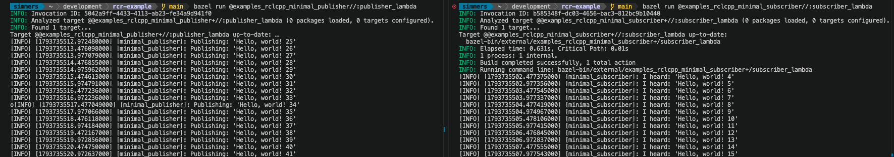
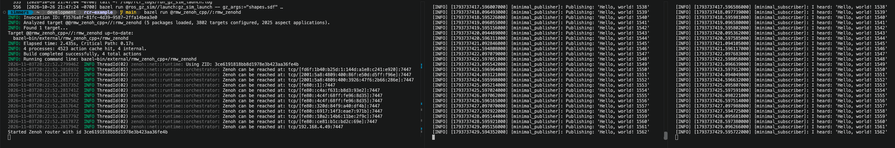
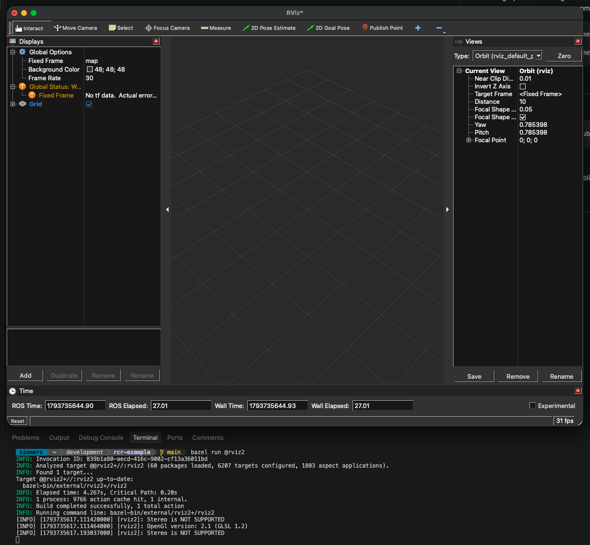

# RCR Examples

The ROS Central Registry (RCR) is a collection of Bazel modules for building ROS packages completely from source within Bazel. Some of its key features are the following:

- It is pinned at a very recent upstream release, `lyrical/2026-10-05`.
- It has immutable modules as releases, ensuring long-term stability.
- It supports FastRTPS, Zenoh, and CycloneDDS.
- It supports both Mac and Linux on arm64 and x86_64.
- It is tested with hermetic-llvm and supports cross-compilation.
- It has unit tests to verify behavior correctness cross-platform.
- It has most packages from rosdistro ported to Bazel.
- It runs CI on desktop_full to make sure building and testing pass.
- It builds everything from source, including Qt 6.10.2 and libtorch.
- It has a user-friendly web-based package manager: https://bazel.ros.org

Make sure you are working in a session that has access to a display, as some examples launch GUIs.

## Linux (amd64 or arm64)

Make sure you have git, Python3, and zip compression tools installed:

```
sudo apt-get update && sudo apt-get install -y git unzip zip
```

Then download bazelisk and put it on your path:

```bash
mkdir -p ~/.local/bin
curl -Lo ~/.local/bin/bazel \
  https://github.com/bazelbuild/bazelisk/releases/latest/download/bazelisk-linux-$(dpkg --print-architecture)
chmod +x  ~/.local/bin/bazel
```

## macOS Tahoe (arm64 only)

Install the system SDK frameworks:

```
xcode-select --install
```

Install Homebrew and then the necessary tools:

```bash
brew install bazelisk git
```

For high-precision timing and benchmarks on macOS, timer coalescing can introduce millisecond jitter into your execution loops. We recommend disabling it before running any time-critical code, and then enabling it again afterwards:

```
sudo sysctl -w kern.timer.coalescing_enabled=0
<run time-critical code>
sudo sysctl -w kern.timer.coalescing_enabled=1
```

# Examples

Check out code:

```python
git clone https://github.com/asymingt/rcr-example.git
cd rcr-example
```

Provided you are on Mac or Linux, you will by default use a pre-warmed remote cache, and so all
build events should complete fairly quickly.

# Basic publisher and subscriber

Pubsub example with FastRTPS (default RMW):

```
bazel run @examples_rclcpp_minimal_publisher//:publisher_lambda
bazel run @examples_rclcpp_minimal_subscriber//:subscriber_lambda
```



# Basic publisher and subscriber with alternate RMW

Start up a zenohd router and then run a publisher and subscriber:

```
bazel run @rmw_zenoh_cpp//:zenohd
bazel run @examples_rclcpp_minimal_publisher//:publisher_lambda \
    --run_env=RMW_IMPLEMENTATION=rmw_zenoh_cpp
bazel run @examples_rclcpp_minimal_subscriber//:subscriber_lambda \
    --run_env=RMW_IMPLEMENTATION=rmw_zenoh_cpp
```



## Rviz2

Launch the Rviz2 robot simulator (needs a display):

```
bazel run @rviz2
```



## MoveIt

Launch an end-to-end MoveIt example with a Universal Robot arm:

```
bazel run @ur_simulation_gz//launch:ur_sim_moveit_launch
```

https://github.com/user-attachments/assets/11c95021-06bb-4ff8-b059-645d902e3f2b

## Nav2

```
bazel run @nav2_bringup//launch:tb3_simulation_launch -- headless:=false
```

https://github.com/user-attachments/assets/acae149d-65d2-4c3e-8288-026dc91ff68b


## Statically compile a node and optimize for size

To build portable binaries, you must specify which RMW middleware implementation you want to use, and then pass `--config portable` to statically link it and perform size optimizations:

```
bazel build @examples_rclcpp_minimal_publisher//:publisher_lambda \
    --@rosdistro//:rmw=rmw_cyclonedds_cpp \
    --config portable

```

Use `du -hs` to measure the resulting file size:

```
du -hs bazel-bin/external/examples_rclcpp_minimal_publisher+/publisher_lambda
6.5M    bazel-bin/external/examples_rclcpp_minimal_publisher+/publisher_lambda
```

Then you can use `otool -L` or `ldd` to see what it links to. For example, on macOS it just requires the Foundation framework, libc++, and libSystem:

```
otool -L bazel-bin/external/examples_rclcpp_minimal_publisher+/publisher_lambda
bazel-bin/external/examples_rclcpp_minimal_publisher+/publisher_lambda:
        /System/Library/Frameworks/Foundation.framework/Versions/C/Foundation (compatibility version 300.0.0, current version 5026.5.4)
        /usr/lib/libc++.1.dylib (compatibility version 1.0.0, current version 2100.43.0)
        /usr/lib/libSystem.B.dylib (compatibility version 1.0.0, current version 1356.0.0)
```

The `bazel-bin/external/examples_rclcpp_minimal_publisher+/publisher_lambda` binary should now be portable across any aarch64 (M-series Mac) with Foundation series 300 and above.

# Next steps

Take a look at https://bazel.ros.org to find ROS packages you'd like to test. When you find one, add it to the [MODULE.bazel](./MODULE.bazel) file and it becomes available with an `@` prefix. For example, `rclpy` is a package in the `desktop_full` variant, so you can just import it this way (the `0.0.0` version is immediately overridden by the resolved version for the release):

```diff
diff --git a/MODULE.bazel b/MODULE.bazel
index 6b2fa67..a2d19e3 100644
--- a/MODULE.bazel
+++ b/MODULE.bazel
@@ -34,6 +34,7 @@ bazel_dep(name = "desktop_full", version = "lyrical.2026-10-05.rcr.0")
 # Declare 0.0.0 versions for the ROS modules you want in the variant above.
 bazel_dep(name = "examples_rclcpp_minimal_publisher", version = "0.0.0")
 bazel_dep(name = "examples_rclcpp_minimal_subscriber", version = "0.0.0")
+bazel_dep(name = "rclpy", version = "0.0.0")
 bazel_dep(name = "rmw_zenoh_cpp", version = "0.0.0")
 bazel_dep(name = "rosdistro", version = "lyrical.2026-10-05.rcr.1")
 bazel_dep(name = "rviz2", version = "0.0.0")
```

To make sure that all tests in `@rclpy` pass, you can run this command (after the edit above). Great care is taken to launch each test in its own network sandbox with multicast disabled, and a cleanup script to ensure no processes are left dangling after the test exits. This gives a nice deterministic result:

```json
bazel test @rclpy//...
INFO: Invocation ID: 339f695d-1180-4fb5-b9dd-4acccfbae754
INFO: Analyzed 65 targets (2102 packages loaded, 133879 targets configured, 3822 aspect applications).
INFO: Found 7 targets and 58 test targets...
INFO: Elapsed time: 69.936s, Critical Path: 34.90s
INFO: 688 processes: 19746 action cache hit, 25 remote cache hit, 605 internal, 115 darwin-sandbox.
INFO: Build completed successfully, 688 total actions
@rclpy//test:test_action_client                                          PASSED in 21.8s
@rclpy//test:test_action_graph                                           PASSED in 4.7s
@rclpy//test:test_action_server                                          PASSED in 15.7s
@rclpy//test:test_async_client                                           PASSED in 8.7s
@rclpy//test:test_async_clock                                            PASSED in 4.6s
@rclpy//test:test_async_node                                             PASSED in 9.4s
@rclpy//test:test_async_publisher                                        PASSED in 3.5s
@rclpy//test:test_async_service                                          PASSED in 4.9s
@rclpy//test:test_async_subscription                                     PASSED in 3.9s
@rclpy//test:test_async_timer                                            PASSED in 9.0s
@rclpy//test:test_callback_group                                         PASSED in 3.1s
@rclpy//test:test_client                                                 PASSED in 10.6s
@rclpy//test:test_clock                                                  PASSED in 8.4s
@rclpy//test:test_context                                                PASSED in 1.8s
@rclpy//test:test_create_node                                            PASSED in 3.6s
@rclpy//test:test_create_while_spinning                                  PASSED in 5.8s
@rclpy//test:test_destruction                                            PASSED in 5.4s
@rclpy//test:test_events_executor                                        PASSED in 14.2s
@rclpy//test:test_expand_topic_name                                      PASSED in 2.9s
@rclpy//test:test_guard_condition                                        PASSED in 3.5s
@rclpy//test:test_init_shutdown                                          PASSED in 4.2s
@rclpy//test:test_lifecycle                                              PASSED in 4.5s
@rclpy//test:test_logging                                                PASSED in 11.7s
@rclpy//test:test_logging_rosout                                         PASSED in 26.3s
@rclpy//test:test_logging_service                                        PASSED in 4.6s
@rclpy//test:test_messages                                               PASSED in 2.3s
@rclpy//test:test_node                                                   PASSED in 6.5s
@rclpy//test:test_parameter                                              PASSED in 2.0s
@rclpy//test:test_parameter_client                                       PASSED in 3.4s
@rclpy//test:test_parameter_event_handler                                PASSED in 8.1s
@rclpy//test:test_parameter_service                                      PASSED in 4.1s
@rclpy//test:test_publisher                                              PASSED in 4.0s
@rclpy//test:test_python_allocator                                       PASSED in 1.3s
@rclpy//test:test_qos                                                    PASSED in 5.9s
@rclpy//test:test_qos_event                                              PASSED in 3.3s
@rclpy//test:test_qos_overriding_options                                 PASSED in 3.3s
@rclpy//test:test_rate                                                   PASSED in 4.2s
@rclpy//test:test_rosout_subscription                                    PASSED in 14.0s
@rclpy//test:test_serialization                                          PASSED in 4.8s
@rclpy//test:test_service                                                PASSED in 3.1s
@rclpy//test:test_service_introspection                                  PASSED in 3.7s
@rclpy//test:test_subscription                                           PASSED in 6.0s
@rclpy//test:test_task                                                   PASSED in 2.6s
@rclpy//test:test_time                                                   PASSED in 2.7s
@rclpy//test:test_time_source                                            PASSED in 29.0s
@rclpy//test:test_timer                                                  PASSED in 5.7s
@rclpy//test:test_topic_endpoint_info                                    PASSED in 3.2s
@rclpy//test:test_topic_or_service_is_hidden                             PASSED in 3.3s
@rclpy//test:test_type_description_service                               PASSED in 7.8s
@rclpy//test:test_type_hash                                              PASSED in 2.6s
@rclpy//test:test_type_support                                           PASSED in 3.3s
@rclpy//test:test_utilities                                              PASSED in 2.9s
@rclpy//test:test_validate_full_topic_name                               PASSED in 3.3s
@rclpy//test:test_validate_namespace                                     PASSED in 2.3s
@rclpy//test:test_validate_node_name                                     PASSED in 2.6s
@rclpy//test:test_validate_topic_name                                    PASSED in 3.3s
@rclpy//test:test_wait_for_message                                       PASSED in 5.8s
@rclpy//test:test_waitable                                               PASSED in 7.8s

Executed 58 out of 58 tests: 58 tests pass.
```

If you run the test again, Bazel is clever enough to notice that nothing upstream has changed for every test in the suite, and so it gives you back the cached test results.

```json
$ bazel test @rclpy//...
INFO: Invocation ID: 81ff401e-4205-422f-9329-58dbb8596f62
INFO: Analyzed 65 targets (0 packages loaded, 0 targets configured).
INFO: Found 7 targets and 58 test targets...
INFO: Elapsed time: 2.168s, Critical Path: 0.00s
INFO: 1 process: 58 action cache hit, 1 internal.
INFO: Build completed successfully, 1 total action
@rclpy//test:test_action_client                                 (cached) PASSED in 21.8s
@rclpy//test:test_action_graph                                  (cached) PASSED in 4.7s
@rclpy//test:test_action_server                                 (cached) PASSED in 15.7s
@rclpy//test:test_async_client                                  (cached) PASSED in 8.7s
@rclpy//test:test_async_clock                                   (cached) PASSED in 4.6s
@rclpy//test:test_async_node                                    (cached) PASSED in 9.4s
@rclpy//test:test_async_publisher                               (cached) PASSED in 3.5s
@rclpy//test:test_async_service                                 (cached) PASSED in 4.9s
@rclpy//test:test_async_subscription                            (cached) PASSED in 3.9s
@rclpy//test:test_async_timer                                   (cached) PASSED in 9.0s
@rclpy//test:test_callback_group                                (cached) PASSED in 3.1s
@rclpy//test:test_client                                        (cached) PASSED in 10.6s
@rclpy//test:test_clock                                         (cached) PASSED in 8.4s
@rclpy//test:test_context                                       (cached) PASSED in 1.8s
@rclpy//test:test_create_node                                   (cached) PASSED in 3.6s
@rclpy//test:test_create_while_spinning                         (cached) PASSED in 5.8s
@rclpy//test:test_destruction                                   (cached) PASSED in 5.4s
@rclpy//test:test_events_executor                               (cached) PASSED in 14.2s
@rclpy//test:test_expand_topic_name                             (cached) PASSED in 2.9s
@rclpy//test:test_guard_condition                               (cached) PASSED in 3.5s
@rclpy//test:test_init_shutdown                                 (cached) PASSED in 4.2s
@rclpy//test:test_lifecycle                                     (cached) PASSED in 4.5s
@rclpy//test:test_logging                                       (cached) PASSED in 11.7s
@rclpy//test:test_logging_rosout                                (cached) PASSED in 26.3s
@rclpy//test:test_logging_service                               (cached) PASSED in 4.6s
@rclpy//test:test_messages                                      (cached) PASSED in 2.3s
@rclpy//test:test_node                                          (cached) PASSED in 6.5s
@rclpy//test:test_parameter                                     (cached) PASSED in 2.0s
@rclpy//test:test_parameter_client                              (cached) PASSED in 3.4s
@rclpy//test:test_parameter_event_handler                       (cached) PASSED in 8.1s
@rclpy//test:test_parameter_service                             (cached) PASSED in 4.1s
@rclpy//test:test_publisher                                     (cached) PASSED in 4.0s
@rclpy//test:test_python_allocator                              (cached) PASSED in 1.3s
@rclpy//test:test_qos                                           (cached) PASSED in 5.9s
@rclpy//test:test_qos_event                                     (cached) PASSED in 3.3s
@rclpy//test:test_qos_overriding_options                        (cached) PASSED in 3.3s
@rclpy//test:test_rate                                          (cached) PASSED in 4.2s
@rclpy//test:test_rosout_subscription                           (cached) PASSED in 14.0s
@rclpy//test:test_serialization                                 (cached) PASSED in 4.8s
@rclpy//test:test_service                                       (cached) PASSED in 3.1s
@rclpy//test:test_service_introspection                         (cached) PASSED in 3.7s
@rclpy//test:test_subscription                                  (cached) PASSED in 6.0s
@rclpy//test:test_task                                          (cached) PASSED in 2.6s
@rclpy//test:test_time                                          (cached) PASSED in 2.7s
@rclpy//test:test_time_source                                   (cached) PASSED in 29.0s
@rclpy//test:test_timer                                         (cached) PASSED in 5.7s
@rclpy//test:test_topic_endpoint_info                           (cached) PASSED in 3.2s
@rclpy//test:test_topic_or_service_is_hidden                    (cached) PASSED in 3.3s
@rclpy//test:test_type_description_service                      (cached) PASSED in 7.8s
@rclpy//test:test_type_hash                                     (cached) PASSED in 2.6s
@rclpy//test:test_type_support                                  (cached) PASSED in 3.3s
@rclpy//test:test_utilities                                     (cached) PASSED in 2.9s
@rclpy//test:test_validate_full_topic_name                      (cached) PASSED in 3.3s
@rclpy//test:test_validate_namespace                            (cached) PASSED in 2.3s
@rclpy//test:test_validate_node_name                            (cached) PASSED in 2.6s
@rclpy//test:test_validate_topic_name                           (cached) PASSED in 3.3s
@rclpy//test:test_wait_for_message                              (cached) PASSED in 5.8s
@rclpy//test:test_waitable                                      (cached) PASSED in 7.8s

Executed 0 out of 58 tests: 58 tests pass.
```

If you really want to run a specific test again:

```json
$ bazel run @rclpy//test:test_utilities --cache_test_results=False --test_output=streamed
INFO: Invocation ID: b818af55-9839-4ab5-aa32-22c012de44f9
WARNING: Build option --run_under has changed, discarding analysis cache (this can be expensive, see https://bazel.build/advanced/performance/iteration-speed).
INFO: Analyzed target @@rclpy+//test:test_utilities (0 packages loaded, 58709 targets configured, 3813 aspect applications).
INFO: Found 1 target...
Target @@rclpy+//test:test_utilities up-to-date:
  bazel-bin/external/rclpy+/test/test_utilities
INFO: Elapsed time: 4.122s, Critical Path: 0.23s
INFO: 4 processes: 19738 action cache hit, 4 internal.
INFO: Build completed successfully, 4 total actions
INFO: Running command line: external/bazel_tools/tools/test/test-setup.sh ../rclpy+/test/test_utilities ../rclpy+/test/test_utilities.py
exec ${PAGER:-/usr/bin/less} "$0" || exit 1
Executing tests from @@rclpy+//test:test_utilities
-----------------------------------------------------------------------------
=========================================================================================================================================== test session starts ===========================================================================================================================================
platform darwin -- Python 3.12.13, pytest-9.1.1, pluggy-1.6.0
rootdir: /Users/simmers/Library/Caches/bazel/_bazel_simmers/e473a31147ec3708b60d35faee5a14d8/execroot/_main/bazel-out/darwin_arm64-fastbuild/bin/external/rclpy+/test/test_utilities.runfiles
collected 2 items                                                                                                                                                                                                                                                                                         

../rclpy+/test/test_utilities.py ..                                                                                                                                                                                                                                                                 [100%]

================
```

If you want to see verbose output from the pytest engine, you need even more arguments:

```json
bazel test @rclpy//test:test_utilities \
    --cache_test_results=False \
    --test_output=all \
    --test_arg=-vv \
    --test_arg=-s \
    --test_arg=-rA

...

../rclpy+/test/test_utilities.py::TestValidateRemoveRosArgs::test_remove_ros_args PASSED
../rclpy+/test/test_utilities.py::TestUtilities::test_timeout_sec_to_nsec PASSED

==================================== PASSES ====================================
=========================== short test summary info ============================
PASSED ../rclpy+/test/test_utilities.py::TestValidateRemoveRosArgs::test_remove_ros_args
PASSED ../rclpy+/test/test_utilities.py::TestUtilities::test_timeout_sec_to_nsec
============================== 2 passed in 0.17s ===============================
================================================================================
INFO: Found 1 test target...
Target @@rclpy+//test:test_utilities up-to-date:
  bazel-bin/external/rclpy+/test/test_utilities
INFO: Elapsed time: 10.542s, Critical Path: 3.96s
INFO: 5 processes: 19745 action cache hit, 4 internal, 2 darwin-sandbox.
INFO: Build completed successfully, 5 total actions
@rclpy//test:test_utilities                                              PASSED in 1.3s
```